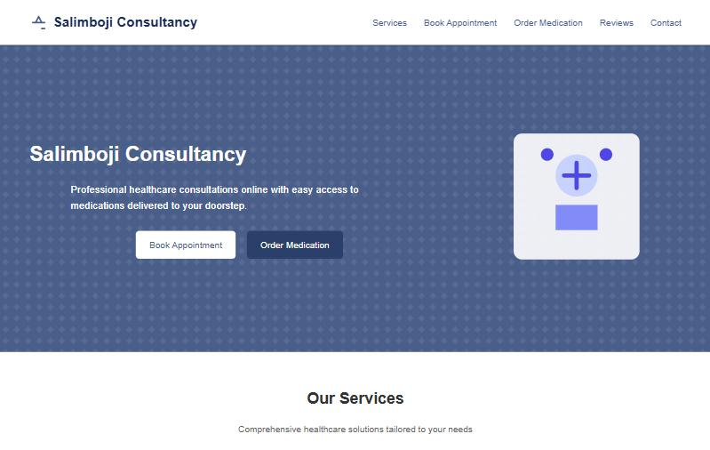

# Salimboji Consultancy: Online Healthcare Website

  

A website for **Salimboji Consultancy**, a healthcare practice offering online consultations and medication delivered to the patient's door.

**Live:** https://letlhogonolo-kgatshe.github.io/salimboji-consultancy-website/

## What's on the page

- A hero section with calls to action for **Book Appointment** and **Order Medication**
- A services overview
- Appointment booking and medication order sections
- Patient reviews
- Contact details
- Responsive layout

## Tech

A single self-contained `index.html` with hand-written HTML, CSS and JavaScript, inline SVG graphics and no dependencies.

## Running locally

Open `index.html` in any browser.

---

Freelance client project (2025) by **Letlhogonolo Kgatshe**.
